# MFPA-FSLR — Đặc tả phương pháp và hướng dẫn triển khai

> **Tên tạm thời:** Motion-First Part-Adaptive Few-Shot Sign Language Recognition (MFPA-FSLR)  
> **Phiên bản đặc tả:** v1.0 — 12/10/2026  
> **Loại bài toán:** Isolated Few-Shot Sign Language Recognition (FSSLR); mở rộng đánh giá cross-lingual.  
> **Trạng thái:** **Thiết kế nghiên cứu cần thực nghiệm**, *không phải* phương pháp đã được kiểm chứng hay một bản tái hiện chính xác paper gốc.  
> **Quyết định kiến trúc:** **Không dùng I3D**. Optical Flow là **input chuyển động chính**; landmarks là **input cấu trúc bổ sung**. Optical Flow estimator được **freeze/tính trước**, còn các encoders và fusion được **training**.

---

## 0. Đọc phần này trước khi code

**Một câu tóm tắt:** Từ video ký hiệu, tiền xử lý để lấy **flow của tay trái, tay phải, miệng** và **landmarks của các vùng này**; học biểu diễn chuyển động–cấu trúc với mức độ tin cậy; giữ embedding riêng từng vùng; xây dựng **prototype theo lớp và theo vùng từ support set**; so khớp query bằng trọng số vùng thích ứng với mỗi few-shot episode.

### 0.1. Quyết định đã chốt (MVP)

| Thành phần | Đặc tả v1 |
|---|---|
| Đầu vào gốc | Video RGB, đã biết nhãn ký hiệu ở meta-train |
| Tính Optical Flow | Dense flow giữa frame liên tiếp; **precompute và freeze estimator** |
| Flow regions | Left Hand (`LH`), Right Hand (`RH`), Mouth (`M`) |
| Structural data | 2 × 21 hand landmarks + vùng mouth landmarks (chọn cố định 40 điểm) |
| Backbone video | **Không dùng I3D, không dùng RGB 3D-CNN** |
| Motion encoder | CNN 2D nhỏ, **chia sẻ trọng số** cho 3 vùng (có part embedding hoặc adapter tùy chọn) |
| Structural encoder | MLP tay dùng chung; MLP miệng riêng vì số điểm khác nhau |
| Fusion | Confidence-gated residual motion–structure fusion |
| Temporal aggregation | Temporal attention pooling **riêng cho từng vùng**, global vector tổng hợp từ 3 vùng |
| Few-shot head | Global prototype + 3 part prototypes; class/episode-dependent weights |
| Train objective | Episodic cross-entropy; regularization tùy chọn sau baseline |
| Protocol đầu tiên | MS-ASL200, 5-way 1-shot và 5-shot, class-disjoint |

**Không triển khai trong v1:** train RAFT end-to-end; mô hình ngôn ngữ/text labels; optical-flow generative loss; temporal alignment phức tạp; decoder để sinh ký hiệu; robot deployment. Đây là các extension, tránh chồng quá nhiều novelty ngay từ đầu.

### 0.2. Cơ sở paper gốc và điểm khác biệt

**Nguồn trực tiếp do người dùng cung cấp:** Yunus Can Bilge, Nazli Ikizler-Cinbis, Ramazan Gokberk Cinbis, *Cross-lingual few-shot sign language recognition*, **Pattern Recognition 151 (2024), 110374**, DOI: <https://doi.org/10.1016/j.patcog.2024.110374>.

- **Tác giả gốc:** I3D trích xuất body và hand visual features; MediaPipe Hands trích xuất hand landmarks; AIS kết hợp các luồng qua self-attention; LBAS tổng hợp thời gian; prototype dùng khoảng cách Euclidean; huấn luyện episodic. Xem Fig. 2, Sec. 3.2–3.4 (trang 2–4).
- **Thiết lập gốc:** MS-ASL200 chia 120/30/50 lớp train/val/test; DGS từ SIGNUM và TID từ AUTSL dùng cho cross-lingual meta-test; 5-way và 20-way, 1-shot và 5-shot. Xem Sec. 4–5 (trang 4–8).
- **Đề xuất của chúng ta:** Bỏ I3D; thay các đầu vào thị giác bằng **flow + landmarks**; dùng **fusion và temporal pooling mới**, giữ embedding theo vùng; thêm **part prototypes + episode-adaptive weighting**.
- **Cảnh báo:** Vì thay nhiều khối cốt lõi, gọi đây là *phương pháp mới lấy cảm hứng từ bài toán/prototype learning của Bilge et al.*, **không** được gọi là “tái hiện chính xác AIS/LBAS” hoặc khẳng định chỉ sửa 1 layer của tác giả.

### 0.3. Các đóng góp nghiên cứu dự kiến (CHƯA xác minh tính mới tuyệt đối)

1. **Motion–Structure Complementary Representation:** biểu diễn chuyển động tay–miệng bằng dense optical flow **kèm quỹ đạo/vị trí và cấu trúc từ landmarks**, không cần I3D. Thử tách motion lớn (di chuyển vùng tay) và motion cục bộ (khớp ngón/môi).
2. **Motion-Reliability-Aware Part Fusion:** điều chỉnh ảnh hưởng của flow theo độ hợp lệ detector/chất lượng chuyển động từng vùng–thời điểm, tránh flow sai làm hỏng embedding.
3. **Episode-Adaptive Discriminative Part Prototypes:** prototype theo vùng và trọng số từng lớp/từng episode dựa trên mức độ phân biệt trên support set; đây là **đóng góp trọng tâm để kiểm chứng**.

> Dùng optical flow, gating hoặc part prototypes **riêng lẻ không tự tạo novelty**. Chỉ có thể kết luận đóng góp sau related-work review và ablation; không hứa hẹn cải thiện accuracy.

---

## 1. Bài toán và ký hiệu

Một episode gồm:

- **Support:** \(\mathcal S=\{(x_{c,k},c)\mid c=1,\ldots,N;\ k=1,\ldots,K\}\).
- **Query:** \(\mathcal Q=\{(q_j,y_j)\}_{j=1}^{NQ}\), nhãn query chỉ dùng tính loss/evaluate.
- **N-way K-shot:** đề xuất train/test `N=5`, `K∈{1,5}`, `Q=5` query mỗi lớp làm cấu hình bắt đầu (giảm Q nếu tài nguyên hạn chế).
- **Body parts:** \(\mathcal R=\{LH,RH,M\}\).
- **Video:** \(V=[I_1,\ldots,I_T]\), \(T=16\) frame được sample; có \(T-1=15\) flow maps.
- **Embedding dimension:** \(d=128\) cho toàn bộ part và global embedding.

### 1.1. Mục tiêu

Học bộ encoder \(E_\theta\) sử dụng các lớp **meta-train**, để trên một **lớp mới chưa xuất hiện lúc training**, chỉ cần K support samples để phân loại query. Không cập nhật tham số mạng trong từng episode ở phiên bản v1; chỉ tạo prototype từ support set.

### 1.2. Sơ đồ kiến trúc (Mermaid; preview được trên GitHub hỗ trợ Mermaid)

```mermaid
flowchart LR
    A[RGB sign video] --> B[Sample 16 frames and detect landmarks]
    B --> C[Dense optical flow on aligned full frames]
    C --> D[Crop 3 flow regions: LH / RH / Mouth]
    B --> E[Hand and mouth landmark sequences]
    D --> F[Trainable motion CNN]
    E --> G[Trainable structural MLP]
    F --> H[Part-wise reliability-gated fusion]
    G --> H
    H --> I[Part-aware temporal pooling]
    I --> J[Embeddings: global + LH + RH + Mouth]
    J --> K[Support: class-part prototypes]
    J --> L[Query: part-wise embeddings]
    K --> M[Episode-adaptive region weights]
    M --> N[Weighted prototype distances]
    K --> N
    L --> N
    N --> O[Class logits and CE loss]
```



**Các nhánh support/query đều dùng chung encoder \(E_\theta\).** Không có đường nối dùng nhãn query để tính prototype/trọng số. Khối tính Flow/landmarks là preprocessing; bắt đầu backprop từ Motion CNN và Structural MLP.

---

## 2. Tiền xử lý video — triển khai **trước** khi training

### 2.1. Định dạng dataset và metadata

Một hàng trong `metadata.csv` tối thiểu:

```csv
video_id,path,gloss,class_id,language,signer_id,split
v0001,/data/videos/v0001.mp4,HELLO,12,ASL,signer_01,train
```

- `gloss` và `class_id`: chỉ dùng để lập episode; không truyền vào encoder.
- `signer_id`: nếu bộ dữ liệu không có, dùng chuỗi rỗng, **không tự bịa**.
- Lưu thông tin `original_fps`, `sampled_frame_ids`, width, height, cờ `is_mirrored`, metadata MediaPipe version.
- **Tách lớp train/val/test từ đầu**; cùng gloss tuyệt đối không xuất hiện đồng thời trong hai split của monolingual novel-class setting. Dùng *đúng danh sách class IDs* từ protocol nếu muốn so sánh kết quả gốc.

### 2.2. Frame sampling

1. Decode video với OpenCV/Decord/PyAV.
2. Áp dụng **letterbox (giữ aspect ratio)** để có canvas `256×256` cố định cho thuật toán flow và MediaPipe; lưu phép biến đổi tọa độ.
3. Sample `T=16` frame theo chỉ số thời gian tăng dần trên toàn clip. **MVP: uniform deterministic sampling** để cache ổn định; khi training có thể tạo thêm 1–2 lựa chọn temporal sampling đã tiền tính.
4. Nếu video dưới 16 frame, lặp frame cuối và tạo `valid_transition_mask` cho những cặp bị lặp; không coi zero-flow do padding là bằng chứng motion thực.
5. Không đảo thứ tự frame; không mặc định horizontal flip (có thể thay nghĩa ký hiệu và đổi LH/RH).

**Output:** `rgb[16,256,256,3]` (uint8), `frame_ids[16]` và `transition_valid[15]`.

### 2.3. Landmark extraction

Dùng MediaPipe Holistic hoặc Pose + Hands + Face Mesh (cố định phiên bản để tái lập):

- `hand_lm`: `[16,2,21,3]` (`LH`, `RH`; tọa độ x/y normalized trong canvas; z theo MediaPipe).
- `mouth_lm`: `[16,40,3]` với **40 indices thuộc đường viền môi**, danh sách index cố định lưu `mouth_indices.json`. Số 40 là thiết lập đề xuất, **không phải thông số tác giả Bilge et al.**
- `hand_valid`: `[16,2]`, `mouth_valid`: `[16]` là cờ track/detection hợp lệ; có thể kèm detection confidence nếu API trả về.
- `hand_center`: `[16,2,2]`, `mouth_center`: `[16,2]` trong tọa độ toàn frame để bảo toàn quỹ đạo (không chỉ tọa độ tương đối).
- `roi_box`: `[16,3,4]`, mỗi hộp (`x1,y1,x2,y2`) trên canvas 256×256.

**Quan trọng:** MediaPipe không nhất thiết cung cấp confidence đã hiệu chuẩn cho từng điểm tay. Nếu không có confidence, dùng valid track `0/1` và chỉ số chất lượng có định nghĩa rõ; **không suy diễn số tin cậy ngẫu nhiên**. Không có detection thì tạo mask 0, không dùng placeholder 0 như landmarks thật.

**Chọn ROI:** tay: bounding box của 21 landmarks với margin 1.4–1.6×; miệng: bounding box của mouth indices với margin 1.5–2×. Với chuyển động rất lớn, có thể union ROI từ `t` và `t+1`. Thông số cụ thể đưa vào config và kiểm tra trực quan.

**Left/Right convention:** dùng nhãn bàn tay theo hệ giải phẫu đã cố định; kiểm tra camera ảnh gương trước khi gán nhãn; không đổi theo bên trái/phải trên ảnh một cách tùy tiện.

### 2.4. Dense optical flow

Với cặp frame liên tiếp \((I_t,I_{t+1})\):

\[
O_t=\mathrm{FlowEstimator}(I_t,I_{t+1})\in\mathbb R^{256\times256\times2},\quad t=1,\ldots,15.
\]

- `O_t[:,:,0] = u`: pixel displacement theo trục x trên **canvas đã resized**.
- `O_t[:,:,1] = v`: pixel displacement theo trục y.
- Flow estimator là **thuật toán/model tạo input**, không phải encoder few-shot cần training.
- Lựa chọn cho MVP: `OpenCV Farnebäck` để kiểm thử pipeline nhanh hoặc pretrained `RAFT-Small` (frozen) để chạy main experiments; cố định estimator khi so sánh ablation.
- Không áp dụng per-video min–max scaling cho flow magnitude (sẽ xóa thông tin cường độ tương đối). Dùng scale global `flow_scale` cố định trên train set rồi clip vào ngưỡng được chọn ở validation.

**Quy tắc kỹ thuật bắt buộc:** tính dense optical flow **trên full aligned frames trước**, rồi ROI-sample **flow field**. Không crop một ROI khác nhau ở mỗi frame rồi mới tính flow một cách tùy tiện; sự thay đổi vị trí crop gây motion giả hoặc làm mất quỹ đạo thật.

Tính ROI theo vùng có thể dùng center giữa hai frame hoặc union boxes `t` và `t+1`. Crop flow bằng `grid_sample`/`roi_align` thành `64×64`; khi biến đổi hệ tọa độ, chuyển displacement tương ứng: \(u_{ROI}=u_{canvas}(64/w_{ROI})\), \(v_{ROI}=v_{canvas}(64/h_{ROI})\). Nếu muốn giữ flow theo pixel trên canvas, có thể **không** đổi đơn vị, nhưng phải nhất quán trong train/test và tài liệu config.

\[
O_t^r=\operatorname{CropAndRescale}(O_t,B_t^r)\in\mathbb R^{64\times64\times2}.
\]

**Output:** `flows[3,15,2,64,64]` (`float16/float32`; channel first; r theo LH,RH,M); `flow_valid[3,15]`.

#### Chuyển động toàn vùng và chuyển động cục bộ

- **Global hand trajectory:** dùng `hand_center[t+1] - hand_center[t]` (hoặc wrist position displacement), vì local flow tại ROI có thể chưa đủ bao quát di chuyển lớn.
- **Local articulation:** CNN học pattern từ dense flow trong ROI, có thể trừ vector translation trung vị trong ROI **như ablation**, nhưng đừng xóa global trajectory.
- **Mouth motion:** có thể bù chuyển động đầu bằng face-landmark rigid alignment **trước khi trích xuất** local lip motion; đặt thành nhánh thí nghiệm riêng, không mặc định thành baseline.

### 2.5. Ước lượng `motion_quality`

Dùng \(q_{r,t}\in[0,1]\) tính từ **thông tin không có nhãn**, ví dụ:

1. `det_valid`: ROI và landmarks ở `t,t+1` hợp lệ.
2. `roi_valid_fraction`: bao nhiêu diện tích ROI nằm trong khung hình.
3. *(tùy chọn chính thức)* `fb_consistency`: đo sai số forward–backward flow, cần tính thêm backward flow; báo rõ tăng chi phí preprocessing.

MVP:

\[
q_{r,t}=\mathrm{det\_valid}_{r,t}\;\mathrm{roi\_valid\_fraction}_{r,t}
\]

Có thể thêm: \(q=\operatorname{clip}(q_{det}\,q_{roi}\,q_{fb},0,1)\). Đừng gọi `q` là độ đúng đã hiệu chuẩn nếu chưa đánh giá.

**Flow invalid:** đặt flow bằng 0 **và mask bằng 0**; không được coi vector 0 là chuyển động thật. Nếu missing toàn vùng, model vẫn có thể dùng global embedding từ các vùng còn lại.

### 2.6. Cấu trúc feature cache

```text
data/
  splits/{train,val,test}_classes.json
  metadata.csv
  processed/
    v0001.npz   # hoặc shards: HDF5/LMDB/WebDataset
    v0002.npz
  preprocessing_config.yaml
  mouth_indices.json
```

`v0001.npz` đề xuất chứa:

| Key | Shape | Ghi chú |
|---|---|---|
| `flow` | `[3,15,2,64,64]` | LH,RH,M; normalized theo cùng config |
| `hand_lm` | `[16,2,21,3]` | tọa độ normalized, chưa được chuẩn hóa cục bộ |
| `mouth_lm` | `[16,40,3]` | fixed landmark ordering |
| `hand_center` | `[16,2,2]` | tọa độ canvas normalized |
| `mouth_center` | `[16,2]` | tọa độ canvas normalized |
| `flow_quality` | `[3,15]` | confidence proxy trong `[0,1]` |
| `hand_valid` | `[16,2]` | mask |
| `mouth_valid` | `[16]` | mask |
| `transition_valid` | `[15]` | mask những frame-pairs thật |
| `sampled_frame_ids` | `[16]` | để debug |

**Caching:** giữ hash của preprocessing config và phiên bản estimator trong metadata. Nếu đổi frame sampling/ROI/flow estimator phải tạo cache mới.

---

## 3. Chuẩn hóa feature cấu trúc (đưa vào MLP)

Landmarks **không** đi thẳng thành ảnh; chuyển thành vector ở từng flow-step \(t=1,\ldots,15\).

### 3.1. Hand structural vector (`LH`, `RH`)

- Landmark 3D `[21,3]` tại frame `t`.
- Trừ wrist landmark (`index 0`) để lấy **relative handshape**; chia cho kích thước bàn tay/scale ổn định, có epsilon.
- Giữ tọa độ tâm/wrist `xy` trên full canvas `[2]` để biểu diễn **hand location**.
- Giữ velocity của tâm từ `t` tới `t+1` `[2]` để biểu diễn hướng/quỹ đạo.

\[
\ell_{r,t}=[\operatorname{vec}(L_{r,t}-L_{r,t}^{wrist});\;center_{r,t};\;\Delta center_{r,t}]\in\mathbb R^{67}.
\]

Ở đây `67 = 21×3 + 2 + 2` (3D wrist-relative vector có ba giá trị 0; giữ cho dễ code). Biến đổi scale trên cả x/y/z nên xác định rõ quy tắc; không giả định z của MediaPipe là metric depth.

### 3.2. Mouth structural vector

Lấy 40 landmarks vùng môi, trừ mouth-center và chuẩn hóa bằng kích thước vùng mặt/miệng, đồng thời giữ mouth center và delta mouth center trên canvas:

\[
\ell_{M,t}\in\mathbb R^{124},\quad124=40\times3+2+2.
\]

Nếu có face-rotation normalization, báo nó như một lựa chọn riêng. Lưu ý việc standardize môi **không** tự động tách được mọi ảnh hưởng lip articulation so với head movement.

### 3.3. Các shape khi đi vào trainable network

Với video batch `B`:

```text
flow               [B, 3, 15, 2, 64, 64]
hand_struct         [B, 2, 15, 67]
mouth_struct        [B, 15, 124]
quality             [B, 3, 15]
valid_mask          [B, 3, 15]    # valid part / transition
```

Các tensor float32 ở đầu vào training; cache lưu float16 vẫn được nếu kiểm tra overflow/underflow. Indices `0,1,2` lần lượt `LH, RH, M`.

---

## 4. Trainable Network — biểu diễn toán học và shape

### 4.1. Motion Encoder — `E_m`

Nhận mỗi flow field `O_{r,t}` kích thước `[2,64,64]`.

MVP dùng CNN 2D nhỏ:

```text
Conv2d(2, 32, kernel=3, stride=2, padding=1) + BatchNorm + GELU
Conv2d(32,64, kernel=3, stride=2, padding=1) + BatchNorm + GELU
Conv2d(64,128,kernel=3, stride=2, padding=1) + BatchNorm + GELU
AdaptiveAvgPool2d(1) + Flatten
Linear(128,128)
```

Flatten `(B×3×15)` để đưa qua cùng một MotionCNN → reshape:

\[
M=E_m(O)\in\mathbb R^{B\times3\times15\times128}.
\]

Để thí nghiệm, có thể dùng cùng MotionCNN cho 3 vùng rồi cộng `learnable_part_embedding[r]`. Tách CNN cho miệng có thể tăng tham số và phải có ablation.

### 4.2. Structural Encoder — `E_s`

- Shared hand MLP: `Linear(67,128) → GELU → Linear(128,128)`.
- Mouth MLP riêng: `Linear(124,128) → GELU → Linear(128,128)`.
- Stack theo thứ tự `LH,RH,M`:

\[
S=E_s(L)\in\mathbb R^{B\times3\times15\times128}.
\]

Do raw landmark x/y và z có thang khác nhau, chuẩn hóa bằng thống kê **train only** hoặc relative coordinates cố định; áp dụng đúng thống kê đó trên val/test.

### 4.3. Reliability-Gated Fusion (Novelty dự kiến #2)

Dữ liệu đầu vào cho gate: motion features `M`, structural features `S`, quality scalar `q` (broadcast):

\[
\tilde g_{r,t}=\sigma\!\left(\operatorname{MLP}_g([M_{r,t};S_{r,t};q_{r,t}])\right),
\]
\[
g_{r,t}=q_{r,t}\,\tilde g_{r,t},\qquad
H_{r,t}=\operatorname{LN}\!\left(S_{r,t}+g_{r,t}\odot M_{r,t}\right).
\]

**Quan trọng:** `q=0 ⇒ g=0` nên flow invalid không trực tiếp đi vào fusion. `q` là giá trị từ preprocessing, `MLP_g` là trainable; có thể dùng scalar gate `[B,3,15,1]` để giảm số tham số (MVP), hoặc channel-wise `[B,3,15,128]` ở ablation.

Đặt `valid_mask=0` nếu cả structural và motion đều không hợp lệ. Nếu chỉ thiếu flow nhưng còn landmarks, `H≈S` được phép. Nếu toàn bộ ROI invalid, loại khỏi temporal pooling để tránh fake evidence.

### 4.4. Part-aware Temporal Aggregation

**Không nhầm với LBAS chính xác của Bilge et al.** Đây là thiết kế pooling theo thời gian **riêng cho mỗi vùng**, bảo toàn các embedding part-wise.

Với \(r\), `H_r` shape `[B,15,128]`:

\[
e_{r,t}=w_a^\top\tanh(W_aH_{r,t}+b_a),
\quad
 a_{r,t}=\operatorname{masked\_softmax}_t(e_{r,t}),
\]
\[
 z^r=\operatorname{normalize}\!\left(\sum_{t=1}^{15}a_{r,t}H_{r,t}\right)\in\mathbb R^{128}.
\]

Dùng masked-softmax ổn định: nếu cả chuỗi r không hợp lệ, trả vector 0 và region quality 0; **không được ra NaN**.

Global embedding **không từ I3D**, tạo bằng projection từ concatenation ba part vectors:

\[
 z^G=\operatorname{normalize}\big(\operatorname{MLP}_G([z^{LH};z^{RH};z^M])\big)\in\mathbb R^{128}.
\]

Cách triển khai dễ kiểm soát hơn: nhân part vector với mask/mean-quality trước khi concat, tránh region missing gây nhiễu. `z^G` sẽ được học hoàn toàn từ các vùng này, do đó **không giữ được ngữ cảnh toàn thân như I3D** — đây là trade-off cần báo cáo.

**Output của `encode_video()`:**

```python
{
  "global": z_global,    # [B,128]
  "parts": z_parts,      # [B,3,128]
  "part_quality": q_bar, # [B,3], trung bình valid quality trên thời gian
}
```

---

## 5. Few-Shot Prototype Head (đóng góp trọng tâm #3)

### 5.1. Class prototypes từ support set

Từ encoder, support có:

```text
support.global         [N,K,128]
support.parts          [N,K,3,128]
support.part_quality   [N,K,3]
query.global           [N*Q,128]
query.parts            [N*Q,3,128]
```

Prototype global:

\[
p_c^G=\operatorname{norm}\left(\frac{1}{K}\sum_{k=1}^{K}z_{c,k}^G\right).
\]

Prototype vùng:

\[
p_c^r=\operatorname{norm}\left(
\frac{\sum_k q_{c,k}^r z_{c,k}^r}{\sum_k q_{c,k}^r+\varepsilon}
\right).
\]

**Vì sao weighted mean?** Khi mouth flow/hands bị missing ở một support sample, không nên cho sample đó ảnh hưởng bằng sample hợp lệ. Nếu \(\sum_k q=0\), prototype vùng được mask là invalid, không ép vector zero thành đơn vị. Ở baseline ablation, thay weighted mean bằng average đều để đo riêng đóng góp của quality weighting.

### 5.2. Discriminability từ các prototype **trong support set**

Đặt \(D_{c,r}\) đo mức khác biệt vùng r của lớp c so với N−1 lớp còn lại:

\[
D_{c,r}=\frac{1}{N-1}\sum_{c'\ne c}
\big(1-\langle p_c^r,p_{c'}^r\rangle\big).
\]

Chỉ tính trên class-part prototypes hợp lệ; class/part thiếu dữ liệu nhận điểm thấp hoặc mask trong softmax; tránh chia sai khi không có lớp đối chứng hợp lệ.

**Interpretation:** một vùng có thể rất hữu ích ở episode A nhưng vô ích ở episode B. Cơ chế này cố gắng chọn vùng phân biệt tốt trong tập N lớp hiện tại, thay vì learned global attention cố định theo dữ liệu meta-train.

### 5.3. Reliability + discriminability → `alpha`

\[
Q_{c,r}=\frac{1}{K}\sum_k q_{c,k}^r,
\]
\[
 a_{c,r}=\beta_DD_{c,r}+\beta_Q\log(Q_{c,r}+\varepsilon),
\]
\[
 \widehat\alpha_{c,:}=\operatorname{masked\_softmax}_r(a_{c,:}/\tau_\alpha),
\qquad \alpha_{c,:}=(1-\rho)\,U_{c,:}+\rho\,\widehat\alpha_{c,:}.
\]

Trong đó `U` là phân phối đều trên **những vùng hợp lệ** của lớp c; `rho∈[0,1]` giảm overconfidence ở 1-shot. Thử bắt đầu `beta_D=1, beta_Q=0.5, tau_alpha=1, rho=0.8` như **giả định để chạy code**; không coi là tối ưu. `beta`, `tau`, `rho` là hyperparameter chọn bằng val, không dùng test để tune.

Nếu toàn bộ vùng không hợp lệ: `alpha` nhận vector 0; chỉ còn global branch nếu global valid. Nếu toàn bộ video vô hiệu, đánh dấu failed sample và xử lý theo protocol công bố, không âm thầm dự đoán có căn cứ.

### 5.4. Class score và loss

Với các embeddings và prototypes L2-normalized, squared Euclidean distance:

\[
d(x,p)=\|x-p\|_2^2=2-2\cos(x,p).
\]

\[
\boxed{
 s_c(q)=-d(z_q^G,p_c^G)
 -\lambda\sum_{r\in\{LH,RH,M\}}
\alpha_{c,r}\,d(z_q^r,p_c^r)
}
\]

Nếu một vùng **query** không hợp lệ, nên mask nó trong part score và **renormalize weights trên các vùng query-class hợp lệ** (hoặc dùng query-quality factor có ablation). **Không** để invalid zero vector tạo khoảng cách có ý nghĩa.

\[
P(y=c\mid q,\mathcal S)=\operatorname{softmax}_c\big(s_c(q)/\tau_s\big),
\]
\[
\mathcal L_{cls}=-\frac{1}{|\mathcal Q|}\sum_{(q,y)\in\mathcal Q}\log P(y\mid q,\mathcal S).
\]

Loss **bắt đầu chỉ dùng** `L_cls`; chỉ thêm metric regularizer sau khi có kết quả ablation. Trong 1-shot, có thể đặt hệ số global cao hơn ở giai đoạn warm-up để giảm noise; đây là lựa chọn sau MVP, không bắt buộc.

---

## 6. Tensor contracts và code khung PyTorch

### 6.1. API nội bộ chuẩn

```python
class MFPAFSLR(nn.Module):
    def encode(self, flow, hand_struct, mouth_struct, quality, valid_mask):
        # return {"global": [B,D], "parts": [B,3,D], "part_quality": [B,3]}
        ...

    def forward_episode(self, support_batch, query_batch, N: int, K: int):
        # features of [N*K] support + [N*Q] query
        # return logits [N*Q,N], diagnostics {"alpha", "part_scores", ...}
        ...
```

### 6.2. Minimal prototype-matching function (có thể đưa vào code)

Đoạn này hiện thực **head** với `support_parts` và `query_parts` được norm theo chiều feature; cần encoder ở phần trước để dùng thật. Có mask cho vùng invalid trên support/query.

```python
import torch
import torch.nn.functional as F


def _norm_or_zero(x, eps=1e-6):
    return x / x.norm(dim=-1, keepdim=True).clamp_min(eps)


def part_proto_logits(sg, sp, sq, qg, qp, qq, lam=1.0,
                      beta_d=1.0, beta_q=0.5, tau_a=1.0,
                      rho=0.8, tau_s=0.2, eps=1e-6):
    """Shapes:
      sg: [N,K,D]       support global
      sp: [N,K,R,D]     support parts (R=3)
      sq: [N,K,R]       support part reliability [0,1]
      qg: [J,D]         query global
      qp: [J,R,D]       query parts
      qq: [J,R]         query part reliability [0,1]
    Returns: logits [J,N], alpha [N,R].
    """
    N, K, R, D = sp.shape
    assert R == 3 and sq.shape == (N,K,R)
    sg, sp = _norm_or_zero(sg), _norm_or_zero(sp)
    qg, qp = _norm_or_zero(qg), _norm_or_zero(qp)

    pg = _norm_or_zero(sg.mean(dim=1))            # [N,D]
    numer = (sp * sq[..., None]).sum(dim=1)      # [N,R,D]
    denom = sq.sum(dim=1)                        # [N,R]
    pp = _norm_or_zero(numer / denom[...,None].clamp_min(eps))
    part_ok = denom > eps                        # [N,R]

    # Cross-class distances: [N,N,R], exclude diagonal and invalid pairs.
    cross_sim = torch.einsum('crd,krd->ckr', pp, pp)
    valid_pair = part_ok[:, None, :] & part_ok[None, :, :]
    not_self = (~torch.eye(N, dtype=torch.bool, device=sp.device))[:, :, None]
    pair_mask = valid_pair & not_self
    cross_d = (1.0 - cross_sim).clamp_min(0)
    pair_count = pair_mask.sum(dim=1)            # [N,R]
    discrim = (cross_d * pair_mask).sum(dim=1) / pair_count.clamp_min(1)

    mean_q = sq.mean(dim=1).clamp(0,1)
    eligible = part_ok & (pair_count > 0)
    scores = beta_d * discrim + beta_q * torch.log(mean_q.clamp_min(eps))
    scores = (scores / tau_a).masked_fill(~eligible, -1e4)
    raw_alpha = torch.softmax(scores, dim=-1) * eligible
    raw_alpha = raw_alpha / raw_alpha.sum(-1,keepdim=True).clamp_min(eps)
    uniform = eligible.float() / eligible.float().sum(-1,keepdim=True).clamp_min(1)
    alpha = (1-rho)*uniform + rho*raw_alpha    # [N,R]

    dg = ((qg[:,None,:] - pg[None,:,:])**2).sum(-1)             # [J,N]
    dp = ((qp[:,None,:,:] - pp[None,:,:,:])**2).sum(-1)        # [J,N,R]
    query_ok = qq > eps                                       # [J,R]
    valid = eligible[None,:,:] & query_ok[:,None,:]            # [J,N,R]
    w = alpha[None,:,:] * valid
    w = w / w.sum(-1,keepdim=True).clamp_min(eps)             # 0 when none valid
    part_dist = (w * dp).sum(-1)                              # [J,N]
    logits = (-dg - lam*part_dist) / tau_s
    return logits, alpha
```

**Kiểm tra head:** Với `N=5,K=1,R=3,D=128,J=25`, đầu ra `logits` phải `[25,5]`, `alpha` `[5,3]`, không NaN, `alpha.sum(-1)=1` với class có ít nhất một vùng eligible; nếu không có eligible thì tổng bằng 0. Mọi sampling/query mask phải có cùng thứ tự region.

**Vấn đề còn mở:** Nếu global embedding hoàn toàn invalid, `dg` cũng phải được mask và sample phải bị đánh dấu lỗi; head phía trên giả định `global` hợp lệ. Xử lý điều kiện này ở `Dataset/Collator` và bộ đánh giá.

### 6.3. Forward training logic

```python
for episode in train_episode_loader:  # N-way K-shot, Q queries/class
    s = episode['support']             # N*K videos
    q = episode['query']               # N*Q videos
    yq = episode['query_labels']       # [N*Q], 0..N-1

    feat_s = model.encode(**s)
    feat_q = model.encode(**q)
    fs = reshape_support(feat_s, N, K)   # [N,K,...]

    logits, alpha = part_proto_logits(
        fs['global'], fs['parts'], fs['part_quality'],
        feat_q['global'], feat_q['parts'], feat_q['part_quality'])
    loss = F.cross_entropy(logits, yq)
    optimizer.zero_grad(set_to_none=True)
    loss.backward()
    torch.nn.utils.clip_grad_norm_(model.parameters(), 1.0)
    optimizer.step()
```

`reshape_support()` phải theo thứ tự class-major; `episode['query_labels']` đánh lại `0..N-1` nội bộ episode, không truyền label ID gốc vào `part_proto_logits`. Nên **encode support/query trong cùng một batch** khi dùng BatchNorm để hạn chế khác biệt thống kê; nếu dùng nhiều episode/mini-batch, cân nhắc GroupNorm thay cho BatchNorm vì few-shot batch nhỏ.

### 6.4. Gradients, freeze, và inference

```text
Raw video → MediaPipe (frozen preprocessing)
          → Optical Flow Estimator (frozen preprocessing)
          → MotionCNN / StructuralMLPs / ReliabilityGate / TemporalPooling
          → z_global, z_parts
          → support prototypes + per-episode alpha
          → query logits → CE loss
```

- Backprop **qua encoders / gate / aggregation**, *không* qua cached optical flow estimator.
- Việc tính alpha từ embeddings/support prototypes là differentiable; nếu không `detach`, gradient có thể đi qua trọng số alpha tới support embeddings. Giữ differentiable ở bản chính; kiểm tra ablation `detach(alpha)` nếu training bất ổn.
- Tại test: **không fine-tune trên query labels**; chỉ tạo support prototypes, phân loại query.

---

## 7. Episodic dataset / sampling

### 7.1. EpisodeSampler

1. Từ class pool của split hiện tại, random chọn N class IDs khác nhau.
2. Từng class chọn `K` **support video IDs** và `Q` **query video IDs** không trùng.
3. Remap nhãn về `0..N-1` theo thứ tự class IDs đã sample.
4. Train: lặp vô hạn hoặc `episodes_per_epoch` cố định, log random seed.
5. Evaluation: sinh danh sách episode và `save .json` cố định **cho mọi model**; không sample lại độc lập giữa các phương pháp.

Ví dụ `N=5, K=1, Q=5` ⇒ 5 support + 25 query; `N=5, K=5, Q=5` ⇒ 25 support + 25 query.

Không để cùng `video_id` vào support/query, ngay cả khi augmentation khác nhau. Trong đánh giá cross-signer, xác thực thêm `signer_id` khi protocol yêu cầu.

### 7.2. Pseudocode sampler

```python
def sample_episode(class_to_videos, N=5, K=1, Q=5, rng=None):
    classes = rng.sample(list(class_to_videos), N)
    support, query = [], []
    for epi_y, orig_class in enumerate(classes):
        ids = rng.sample(class_to_videos[orig_class], K + Q)
        support.extend((vid, epi_y) for vid in ids[:K])
        query.extend((vid, epi_y) for vid in ids[K:])
    return support, query
```

Bảo đảm mỗi class có ít nhất `K+Q` video; có thể giảm `Q` theo dataset, **không tự ý sampling with replacement** tại validation/test.

---

## 8. Training configuration gợi ý

### 8.1. YAML mẫu

```yaml
seed: 42
experiment: mfpa_fslr_v1
data:
  target_frames: 16
  canvas_size: 256
  roi_size: 64
  regions: [left_hand, right_hand, mouth]
  mouth_landmark_count: 40
  flow_estimator: raft_small_pretrained_frozen  # MVP CPU: farneback
  flow_representation: roi_pixel_displacement
  cache_dtype: float16
model:
  dimension: 128
  motion_encoder: small_cnn2d
  structural_encoder: mlp
  fusion: quality_gated_residual
  temporal_pooling: masked_attention
  part_weights: episode_discriminability_quality
  beta_d: 1.0
  beta_q: 0.5
  tau_alpha: 1.0
  rho: 0.8
  lambda_part: 1.0
  tau_score: 0.2
training:
  n_way: 5
  k_shot: 1
  queries_per_class: 5
  episodes_per_epoch: 1000
  max_epochs: 100
  optimizer: adamw
  lr: 0.0001
  weight_decay: 0.0001
  grad_clip: 1.0
  checkpoint_metric: val_5way_1shot_acc
  amp: true
evaluation:
  k_shot: [1, 5]
  n_way: [5, 20]
  n_episodes: 1000
  seeds: [42, 123, 2026]
```

Mọi hyperparameter là **giá trị khởi tạo để thử**, chưa phải kết quả tuning. `n_way=20` chỉ chạy khi số video/lớp và compute cho phép.

### 8.2. Lịch triển khai gợi ý

| Thứ tự | Cần chạy | Kết quả đạt yêu cầu |
|---|---|---|
| 0 | 20 video chạy preprocessing | Overlay ROI/flow đúng LH/RH/M, mask đúng |
| 1 | Smoke test feature encoder | Shapes đúng, loss finite, gradient về CNN/MLP |
| 2 | Landmark-only ProtoNet | Accuracy > chance trên split nhỏ; model overfit 1 episode được |
| 3 | Flow-only ProtoNet | Có thể training; test xem flow giúp gì |
| 4 | Flow + Landmark, simple sum | Fusion baseline không reliability |
| 5 | Reliability gate | Chạy stable; có cải thiện khi flow nhiễu/missing |
| 6 | Global + part prototypes (uniform) | Tách đóng góp part prototypes |
| 7 | Full episode-adaptive alpha | Kiểm tra tăng accuracy trên val và hard classes |
| 8 | Cross-lingual test và hiệu năng | Kiểm tra generalization và cost |

Không thêm nhiều module cùng lúc. Chỉ khi stage trước qua unit tests mới chuyển stage sau.

---

## 9. Ablation và benchmark cần báo cáo

### 9.1. Những phương pháp so sánh tối thiểu

| ID | Optical flow | Landmarks | Quality gate | Part prototype | Adaptive alpha |
|---|---|---|---|---|---|
| A0 | ✗ | ✓ | ✗ | ✗ | ✗ |
| A1 | ✓ | ✗ | ✗ | ✗ | ✗ |
| A2 | ✓ | ✓ | ✗ (sum/concat) | ✗ | ✗ |
| A3 | ✓ | ✓ | ✓ | ✗ | ✗ |
| A4 | ✓ | ✓ | ✓ | ✓ | ✗ (uniform) |
| **A5 Full** | ✓ | ✓ | ✓ | ✓ | ✓ |

Thí nghiệm riêng: **Hand-only**, **Hand+Mouth**, **Mouth-only**, RAFT vs Farnebäck, confidence mask vs no mask, global+local hand flow, shared motion CNN vs separate mouth adapter.

**Điểm cốt lõi:** nếu *A5 không tốt hơn A4*, Novelty #3 chưa được chứng minh. Nếu Hand+Mouth không tốt hơn Hand-only, không nên khẳng định mouth flow giúp một cách phổ quát; phân tích khi nào hữu ích/khi nào gây hại.

### 9.2. Datasets

- **MS-ASL200 từ paper gốc:** 200 classes, split **120 train / 30 val / 50 test**; 5-way/20-way và 1-shot/5-shot. Muốn so sánh paper gốc phải tái sử dụng đúng subset và episode/evaluation protocol gần nhất có thể.
- **SIGNUM (DGS) và AUTSL (TID):** đánh giá cross-lingual sau train trên ASL; các ngôn ngữ đích chỉ làm meta-test. Paper gốc dùng các subset được định nghĩa cụ thể (Synonym-Train-20, Synonym-Test-20, Distinct-20, Combined-40, Comprehensive-60 tùy ngôn ngữ).
- **WLASL/ASL Citizen:** có thể làm thí nghiệm mở rộng, nhưng nếu dùng chúng thì cần xây dựng và công bố class-disjoint protocol riêng; không dùng accuracy trên split supervised chuẩn để đối chiếu trực tiếp với few-shot split của Bilge.

### 9.3. Số liệu paper Bilge et al. để tham khảo (không phải kết quả của ta)

Báo cáo trên **MS-ASL200 meta-test**: 5-way 1-shot **73.9%**, 5-way 5-shot **88.1%**, 20-way 1-shot **52.2%**, 20-way 5-shot **72.4%** (Table 5, trang 8 của PDF). **Không gọi là head-to-head** nếu split/frame preprocessing/support sampling không giống nhau.

### 9.4. Metrics

1. `Mean episodic accuracy (%)` với 95% confidence interval theo episode (nêu phương pháp tính và số episode); dùng nhiều training seeds.
2. Per-class và **hard-class confusion**: chọn hard classes từ *validation*, tránh định nghĩa bằng test results rồi tuning.
3. Mouth / hand occlusion stress test; artificially corrupt flow tại inference, kiểm tra robustness.
4. Motion quality buckets (good/medium/poor) và performance per bucket.
5. Latency **bao gồm preprocessing + flow estimation + landmarks + model**, GPU peak memory, parameter count, FLOPs (nếu đo được), throughput.
6. Cross-signer và cross-lingual để kiểm tra giao thoa giữa mouth/language identity và gesture.

---

## 10. Những lỗi phổ biến cần tránh (rất quan trọng)

- **Flow không phải nhãn** và estimator pretrained **không tự động được fine-tune**.
- **T=16 → 15 flow maps**, cần align landmarks theo `t=0..14` và delta `t→t+1`. Không cộng trực tiếp `[16,...]` với `[15,...]`.
- Không tính flow trên hai crop độc lập có ROI thay đổi mà không chỉnh tọa độ.
- Không dùng flow magnitude một mình; **vector u,v** cần giữ hướng chuyển động.
- Không xóa hand translation khi bù local motion; cần hand-location trajectory riêng.
- Không đổi left/right do mirror camera; kiểm tra handedness consistency.
- Không thay missing landmarks bằng tọa độ 0 rồi để mô hình coi như phát hiện hợp lệ.
- Mouth motion có thể chịu ảnh hưởng ngôn ngữ/cách mouthing của người ký hiệu; không mặc định giúp cross-lingual.
- Không xây prototype từ query hoặc tính alpha dùng nhãn query; hỗ trợ chỉ đến từ support set.
- Không tune hyperparameter trên test set; không dùng chung videos giữa support/query.
- Không coi việc bỏ I3D mặc nhiên giảm tổng thời gian inference: **precomputed flow khác online flow**. Báo cả thời gian RAFT.
- Không coi ba module trong sơ đồ là ba novelty đã được công nhận; phải kiểm tra related works và ablations.

---

## 11. Cấu trúc thư mục Python đề xuất

```text
mfpa_fslr/
├── README.md
├── configs/
│   ├── preprocess.yaml
│   └── train_5w1s.yaml
├── data/
│   ├── metadata.csv
│   ├── splits/
│   └── processed/
├── scripts/
│   ├── build_metadata.py
│   ├── extract_landmarks.py
│   ├── extract_flow.py
│   ├── pack_features.py
│   ├── train.py
│   ├── evaluate.py
│   └── visualize_flow.py
├── src/
│   └── mfpa/
│       ├── datasets/
│       │   ├── feature_dataset.py
│       │   ├── episode_sampler.py
│       │   └── collate.py
│       ├── models/
│       │   ├── motion_encoder.py
│       │   ├── structural_encoder.py
│       │   ├── fusion.py
│       │   ├── temporal_pool.py
│       │   ├── prototype_head.py
│       │   └── mfpa_model.py
│       ├── preprocessing/
│       │   ├── video_frames.py
│       │   ├── roi.py
│       │   ├── landmarks.py
│       │   └── optical_flow.py
│       └── utils/
│           ├── metrics.py
│           ├── masks.py
│           └── seed.py
├── tests/
│   ├── test_flow_coordinates.py
│   ├── test_landmark_shapes.py
│   ├── test_missing_regions.py
│   ├── test_proto_head.py
│   ├── test_episode_no_leakage.py
│   └── test_gradients.py
└── outputs/
    ├── checkpoints/
    ├── logs/
    └── figures/
```

### 11.1. Trình tự code theo file

1. `video_frames.py`, `landmarks.py`, `optical_flow.py` → xuất cache và overlay debug.
2. `feature_dataset.py`, `episode_sampler.py` → đúng tensor & split.
3. `motion_encoder.py`, `structural_encoder.py` → unit tests.
4. `fusion.py`, `temporal_pool.py` → quality mask & không NaN.
5. `prototype_head.py` → chạy function ở §6.2 và gradient test.
6. `mfpa_model.py`, `train.py`, `evaluate.py` → end-to-end train/eval.

---

## 12. Unit tests / điều kiện hoàn thành v1

```python
# 1. Encoder shapes
assert enc["parts"].shape == (B, 3, 128)
assert enc["global"].shape == (B, 128)
assert enc["part_quality"].shape == (B, 3)

# 2. Episode score
assert logits.shape == (N * Q, N)
assert alpha.shape == (N, 3)
assert torch.isfinite(logits).all()

# 3. Flow invalid ⇒ gate motion must zero
# 4. All-invalid part ⇒ attention masked, no NaN
# 5. Same data split/seed ⇒ deterministic evaluation episode IDs
# 6. Same video never in support & query of one episode
# 7. Nonzero gradients reach motion and structure networks
# 8. When lambda_part=0, score exactly reduces to global ProtoNet head
```

**Sanity experiments:**

- Overfit 1 episode nhỏ, xem CE giảm và accuracy tiến gần 100% (không dùng làm test metric).
- Với optical flow toàn zero và q=0, output phải tương đương Landmark-only path, không NaN.
- Thêm mouth branch nhưng mouth invalid hoàn toàn → mô hình vẫn dự đoán từ tay.
- Shuffle flow theo thời gian chỉ ở validation/debug → đo mức độ mô hình thực sự dựa vào temporal direction.
- Check mirror transform: khi flip `x`, `u→-u`, vùng LH/RH hoán đổi theo quy ước, hình dạng landmarks cũng phải transform; mặc định **không sử dụng augmentation này**.

---

## 13. Quyết định nghiên cứu còn mở (đừng “chốt cứng” khi chưa đo)

| Quyết định | Mặc định v1 | Cách đánh giá |
|---|---|---|
| RAFT-Small vs Farnebäck | Farnebäck cho smoke test; RAFT frozen cho main nếu đủ GPU | Accuracy + total preprocessing cost |
| Khung hình/video | 16 | thử 8/16/32 |
| ROI size | 64 | 48/64/96 |
| Mouth region | 40 điểm từ FaceMesh | mouth on/off, region resolution |
| Temporal encoder | Attention pooling | mean pooling/TCN/Transformer |
| Flow quality | detector + in-frame fraction | +forward-backward consistency |
| Alpha selection | mean prototype dissimilarity | uniform/class-agnostic/shuffled regions |
| Score metric | normalized squared Euclidean | cosine (tương đương sau normalization) |
| I3D-free performance | Chưa biết | so sánh protocol công bằng |

### Bản đồ hướng phát triển sau v1

- **V1 (paper hypothesis):** quality-gated optical flow + landmarks + episode-adaptive part prototypes.
- **V2 (chỉ khi cần):** sub-trajectory / temporal token matching giữa support và query, thay mean prototype video-level.
- **V3 (nếu có mục tiêu robot):** edge/offline flow optimization, causal inference / streaming input, latency và năng lượng trên thiết bị thật.

---

## 14. Checklist cuối trước training lớn

- [ ] Confirm `train/val/test` class IDs và signer IDs; khóa test protocol.
- [ ] Chạy visualization cho ≥20 clip, xác minh mouth/hand ROI và hướng flow.
- [ ] Xác minh unit pixel flow, vector transform, frame alignment.
- [ ] Validate cached tensors và tỉ lệ missing từng dataset/ngôn ngữ.
- [ ] Unit test backward và output finite.
- [ ] Overfit một episode.
- [ ] Landmark-only và Flow-only baselines chạy ổn.
- [ ] Chạy A2/A3/A4/A5 trên **cùng** evaluation episodes.
- [ ] Lưu config/checkpoint/git commit/data split/flow estimator versions.
- [ ] Đánh giá mouth reliability, cross-lingual shift và inference total cost.

---

## 15. Nguồn và phạm vi khẳng định

1. **Bilge, Y. C., Ikizler-Cinbis, N., & Cinbis, R. G. (2024).** *Cross-lingual few-shot sign language recognition.* Pattern Recognition, 151, 110374. <https://doi.org/10.1016/j.patcog.2024.110374>. Các chi tiết AIS, LBAS, I3D, prototype, split và báo cáo kết quả thuộc paper này.
2. **Đặc tả MFPA-FSLR trong tài liệu này:** Các bước optical flow hand/mouth, quality-gated fusion, part-wise temporal pooling, episode-conditioned alpha, chọn 16 frames/64 ROI/128D, mã head và config đều là **thiết kế kỹ thuật được đề xuất ở cuộc trao đổi**, *không phải công thức/siêu tham số đã được xác nhận trong Bilge et al.*
3. Những khẳng định về tính mới tuyệt đối, xếp hạng Q2, cải thiện accuracy hay lợi thế trên robot **chưa được kiểm chứng** trong đặc tả này.

**Định nghĩa phiên bản v1 hoàn thành:** Chạy được preprocessing → cached inputs → training N-way K-shot → evaluation class-disjoint, có `A0…A5` và bảng kết quả tái lập từ cùng episode IDs. Sau đó mới nên cố định phương pháp để vẽ final figure cho paper.
